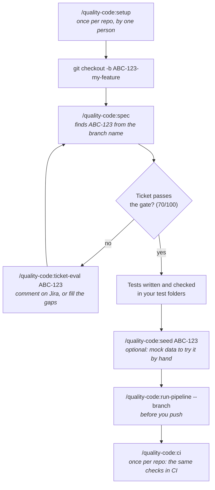
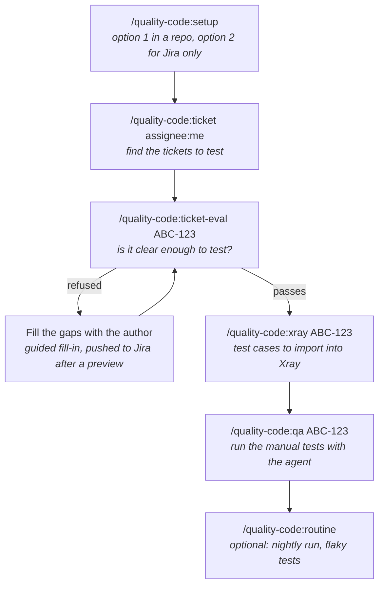
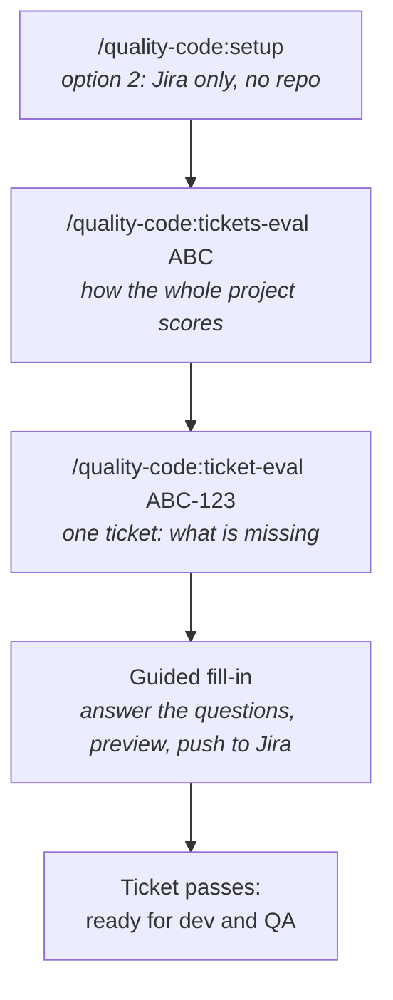

<p align="center">
  
</p>

<p align="center">
  <a href="https://github.com/vissz28/agentic-testing/actions/workflows/test.yml"></a>
  
  
</p>

# Quality Code

**From Jira ticket to tests you can trust, inside Claude Code. One plugin for every team at TeamSystem.**

## Overview

Quality Code connects your Jira tickets to your test suite. It checks that a ticket is clear enough
to test, helps its author fill the gaps, writes tests from the ticket's acceptance criteria, and
grades them. It works with any Jira Cloud project, a backend on **Vitest** (TypeScript, Node),
**pytest** (Python), **JUnit** (Java, Kotlin), **Go** or **.NET** (C#), a frontend on **Playwright**, or
both in one repo (fullstack). Your application code is never changed.

> **The rule everything is built on:** the model reads, drafts and writes, but it **never grades**.
> Every score and every pass/fail comes from a deterministic script.

## Which commands do I run?

New here? [Install](#installation) the plugin first. Then follow the path for your role, top to bottom.
Every command is typed in Claude Code, inside your project folder. Each one answers with a card:
reply with the number of the option you want.

### Developer



### QA



QA in a repo can also write automated tests with `/quality-code:spec ABC-123`, like a developer.

### Product owner / ticket author



### Team lead

Run `/quality-code:setup` once and commit `.claude/quality-code.json`, then `/quality-code:ci` for the
pipeline. Check adoption with `/quality-code:kpi` and cost with `/quality-code:consumption`.

## Commands

Click a command to see its options.

| Command | What it does | You give it | You get back |
|---|---|---|---|
| [`setup`](#setup) | Connects Jira (and GitLab, GitHub, Figma) and saves the project's settings | nothing; answer the cards | `.claude/quality-code.json` to commit |
| [`config`](#config) | Shows and changes the settings, one at a time | nothing; pick an item | the settings card; changes are checked before saving |
| [`ticket`](#ticket) | Finds a Jira ticket and shows it in short | a key, words, or filters like `assignee:me` | the ticket in short, with tips for its author (never posted) |
| [`ticket-eval`](#ticket-eval) | Scores one ticket for test-readiness (70/100 passes) | a ticket key | the score, what is missing, and a way to fix it on Jira |
| [`tickets-eval`](#tickets-eval) | Scores many tickets of a project at once | a project key | one line per ticket, the pass rate, the most common gaps |
| [`spec`](#spec) | From a ticket to written and checked tests | a key, or nothing on a feature branch | test files in your test folders and a verdict card |
| [`run-frontend`](#run-frontend--run-backend--run-pipeline) | Runs and grades the Playwright tests | nothing, or spec paths | a verdict card |
| [`run-backend`](#run-frontend--run-backend--run-pipeline) | Runs and grades the backend tests (Vitest, pytest, JUnit, Go, .NET) | nothing, or spec paths | a verdict card |
| [`run-pipeline`](#run-frontend--run-backend--run-pipeline) | Runs and grades both, frontend and backend | nothing, spec paths, or `--branch` | a verdict card |
| [`seed`](#seed) | Loads realistic mock data for a ticket into your local database | a ticket key | rows in your local DB, to try the ticket by hand |
| [`xray`](#xray) | Writes Xray test cases from a ticket | a ticket key | `case.csv` and `case.xlsx` to import into Xray |
| [`qa`](#qa) | Runs your Xray manual tests in the browser with an agent | a test execution key, or nothing to list yours | a verdict per test you confirm, and drafted defects |
| [`routine`](#routine) | Schedules test runs that run by themselves | a ticket key or nothing, and when | a report each run: green to red, flaky tests |
| [`ci`](#ci) | Writes the CI file for GitHub Actions or GitLab CI | `github` or `gitlab` | a CI file with two jobs |
| [`kpi`](#kpi) | Shows how the plugin is used and the Quality Program numbers | nothing, or a period | a KPI card (read-only) |
| [`consumption`](#consumption) | Shows the AI usage and cost of the plugin's runs | nothing, or a period | a cost table (read-only) |
| [`check-update`](#check-update) | Checks for a newer plugin version | nothing | what changed, and an update on your yes |

Every command starts with `/quality-code:`, for example `/quality-code:spec`. Nothing is written to
Jira without a preview and your yes.

## Command reference

`<KEY>` is a Jira ticket key such as `ABC-123`. `[...]` is optional.

### setup

`/quality-code:setup [advanced]`

Asks where you work (in a repo, or Jira only for QA and PO), checks the connectors, detects the Jira
project and base branch, and writes the config after you confirm. It never checks a ticket.

| Option | What it does |
|---|---|
| `advanced` | Extra questions: feature labels, QA plans, title prefixes, templates, redaction |

### config

`/quality-code:config`

No options. Shows a numbered card: stack, Jira site and projects, base branch, test flow, where files
and logs go, your Jira email, GitLab and Xray settings, and whether each token is set. Pick a number to
change it. Tokens are set in `/plugin`, never in the chat.

### ticket

`/quality-code:ticket <KEY | number | words | filters>`

| Input | Example | Finds |
|---|---|---|
| a key | `ABC-123` | that ticket |
| a number | `123` | the ticket with that number in your project |
| words | `export button` | tickets whose text matches |
| `assignee:me` | `assignee:me` | tickets assigned to you |
| `reporter:<name>` | `reporter:"Jane Doe"` | tickets opened by that person |
| `status:<status>` | `status:"In Progress"` | tickets in that status |
| `label:<label>` | `label:checkout` | tickets with that label |
| `epic:<KEY>` | `epic:ABC-100` | tickets under that epic |
| `text:<words>` | `text:refund` | full-text search |

Filters can be combined: `/quality-code:ticket assignee:me status:"In Progress"`.

### ticket-eval

`/quality-code:ticket-eval <KEY> [--ci] [--json] [--refuse-comment]`

Scores the ticket out of 100; 70 passes. Below 70 it offers three ways on: (1) post a Jira comment
listing what is missing, (2) a guided fill-in that drafts the missing parts and pushes them to Jira
after a preview, (3) continue anyway, marked as a risk.

| Option | What it does |
|---|---|
| `--ci` | No questions. Exits 1 below the bar, so a pipeline can stop on it |
| `--json` | Prints only the score as JSON, nothing else |
| `--refuse-comment` | Prints the Jira comment for a refused ticket, without posting it |

### tickets-eval

`/quality-code:tickets-eval <PROJECT> [--user <name>] [--status <status>] [--limit N | --all] [--json]`

Read-only. Scores the latest tickets of a project, one line each.

| Option | What it does |
|---|---|
| `--user <name>` | Only tickets assigned to that person |
| `--status <status>` | Only tickets in that status, e.g. `--status "To Do"` |
| `--limit N` | How many of the latest tickets (default 50, max 200) |
| `--all` | Every ticket that matches, so the pass rate is the project's, not a sample |
| `--json` | Machine-readable result only |

### spec

`/quality-code:spec [KEY] [options]`

With no key, it takes the ticket from your branch name (`ABC-123-add-export`). Steps: the readiness
gate, a plan you confirm, the tests written in your test folders, the checks, a read-back. It asks at
most three questions. Your application code is never changed.

| Option | Works on | What it does |
|---|---|---|
| `--gate-only` | all | Only the readiness gate, no tests (same as `ticket-eval`) |
| `--base BRANCH` | all | The branch to compare against, when it is not detected |
| `--layer NAME` | backend | Write only in that test layer, e.g. `--layer unit` |
| `--target PATH` | backend | The source file to test, e.g. `--target src/pricing.ts`; skips the question |
| `--route PATH` | frontend | The screen to test, e.g. `--route /orders/new` |
| `--no-extras` | frontend | Only the ticket's scenarios, no extra edge cases |
| `--flow project\|quality-code` | all | Write tests like your existing ones (`project`) or Quality Code's way |
| `--yes` | all | Skip the plan question |
| `--dry-run` | all | The gate and the plan, then stop: nothing written, nothing posted |
| `--ci` | all | No questions; stops where it would have to ask |

On a fullstack repo every option works: `--layer`/`--target` for the backend part, `--route`/`--no-extras` for the frontend part.

### run-frontend · run-backend · run-pipeline

```
/quality-code:run-frontend [spec…] [--key KEY] [--flaky N]
/quality-code:run-backend  [spec…] [--key KEY] [--flaky N]
/quality-code:run-pipeline [spec…] [--branch] [--key KEY] [--flaky N] | --evals
```

With no spec paths they run the whole suite: `run-frontend` the Playwright tests, `run-backend` the
backend tests, `run-pipeline` both. The card shows a verdict, why, and one fix per failing check.

| Option | What it does |
|---|---|
| `spec…` | Run only these test files |
| `--key KEY` | Tie the run to a ticket, so its expected values are checked too |
| `--flaky N` | Run each test N times to catch flaky ones |
| `--branch` | `run-pipeline` only: just the tests your branch added or changed |
| `--evals` | `run-pipeline` only: check that committed ticket specs still pin what they pinned |

### seed

`/quality-code:seed <KEY>`

No options. The ticket must pass the gate. It writes mock data from the ticket's values (the rest
realistic, never real) and loads it into your **local** database only; anything else is refused.
Needs a one-time `seed` block in the config: see [Guide, "Mock data in your local database"](docs/GUIDE.md#mock-data-in-your-local-database).

### xray

`/quality-code:xray <KEY> [--route PATH] [--no-extras] [--dry-run] [--ci] | --sync [KEY]`

| Option | What it does |
|---|---|
| `--route PATH` | The screen the cases are for, e.g. `--route /orders/new` |
| `--no-extras` | Only the ticket's scenarios, no extra edge cases |
| `--dry-run` | The gate and the plan, then stop: no case written |
| `--ci` | No questions |
| `--sync [KEY]` | Rewrite the per-ticket `case.csv`/`case.xlsx` from the main CSV (after you edit it) |

### qa

`/quality-code:qa [KEY] [--app <url>] [--dry-run]`

With no key it lists the test executions assigned to you. It runs each test in the browser, you give
every verdict, and it drafts the defects. Every Jira write is previewed first.

| Option | What it does |
|---|---|
| `KEY` | The test execution to run |
| `--app <url>` | The app address to test on (sign in there first); asked when missing |
| `--dry-run` | The whole run, with every defect and comment shown, nothing sent |

### routine

```
/quality-code:routine [KEY] [--cron "m h dom mon dow" | --at "<date time>"] [--until YYYY-MM-DD] [--stability N] [--branch REF]
/quality-code:routine status [KEY] | list | stop <name>
```

With no options it asks what, when and for how long. Each run fetches what others pushed, runs the
tests, and says when they went from green to red, with the commits in between.

| Option | What it does |
|---|---|
| `KEY` | Only that ticket's tests (default: the whole suite) |
| `--cron "..."` | A repeating schedule in your local time, e.g. `"7 7 * * 1-5"` for weekdays at 07:07 |
| `--at "..."` | Run once at that moment, e.g. `"tomorrow 09:15"` |
| `--until YYYY-MM-DD` | The last day it runs |
| `--stability N` | Run every test N times to track flaky tests and pass rate |
| `--branch REF` | The branch to watch (default: the base branch) |
| `status [KEY]` | Pass rate, flaky tests and green-to-red history of past runs |
| `list` | Your routines, with next and last run |
| `stop <name>` | Remove a routine; its results are kept |

Routines run while the Claude app is open; a run missed while it was closed runs when it opens again.

### ci

`/quality-code:ci [github|gitlab] [--print]`

Writes a CI file with two jobs per pull/merge request: `quality-gate` (seconds: honesty and assertion
checks on the changed tests) and `quality-tests` (types, tests and mutation on what changed).

| Option | What it does |
|---|---|
| `github` / `gitlab` | Which CI to write for (guessed from the repo when left out) |
| `--print` | Show the file without writing it |

### kpi

`/quality-code:kpi [--since 7d|30d|YYYY-MM-DD] [--until YYYY-MM-DD]`

Read-only. Tickets gated, fill-ins, Jira comments, forced runs, verdicts, and the Quality Program
numbers (traceability, completeness, suite honesty, gate integrity, adoption, coverage, mutation kill rate).

| Option | What it does |
|---|---|
| `--since` | Start of the period: `7d`, `30d` or a date |
| `--until` | End of the period |

### consumption

`/quality-code:consumption [--since 7d|30d|YYYY-MM-DD] [--until YYYY-MM-DD] [--by command|ticket|day|model] [--prices file.json]`

Read-only, from Claude Code's local transcripts. Default: the last 30 days, by command.

| Option | What it does |
|---|---|
| `--since` / `--until` | The period |
| `--by` | Group by `command`, `ticket`, `day` or `model` |
| `--prices file.json` | Use your own prices per million tokens |

### check-update

`/quality-code:check-update`

No options. Shows your version, the latest one and what changed, then updates on your yes.

## Works with

| Platform | How | Status |
|---|---|---|
| **Claude Code** (CLI, desktop app) | the plugin: `/plugin install quality-code@teamsystem` | full support: every command, the boundary hook, `routine`, `check-update` |
| **GitHub Copilot** (VS Code) | `quality-code-mcp --init copilot --write`: MCP config and prompt files | every command except `routine` and `check-update`; not yet tried inside Copilot |
| **OpenAI Codex** (CLI, IDE) | `quality-code-mcp --init codex --write`: skills, plus a TOML for `~/.codex/config.toml` | same; not yet tried inside Codex |
| **Cursor** | `quality-code-mcp --init cursor --write`: MCP config and commands | same; not yet tried inside Cursor |
| **Gemini CLI** | `quality-code-mcp --init gemini --write`: an extension folder | same; not yet tried inside Gemini CLI |
| Other MCP clients (Windsurf, Cline, JetBrains, Claude Desktop) | `quality-code-mcp --print-config`, paste the JSON | the tools work; you start commands by asking for the tool |
| Any CI (GitHub Actions, GitLab CI) | `/quality-code:ci github\|gitlab` writes the CI file, which runs `node bin/ci.mjs` | no agent needed: the scripts grade |

The scripts (`bin/*.mjs`) are plain Node and grade the same everywhere. Outside Claude Code the MCP server runs on your
machine over stdio; install it with [`mcp-server/install.sh`](plugins/quality-code/mcp-server/README.md#use-it-in-copilot-codex-cursor-or-gemini-cli).
Without Claude Code's hook, the block on editing code, CI and dependency files during a test-writing run is an instruction to the model only.

## Installation

**Requirements:** Claude Code with plugin support, Node 20+ (22.12+ when setup adds Vitest), a repo
with a `package.json` (setup adds Vitest or Playwright when it has no test runner) or a pytest, JUnit,
Go or .NET project, and access to your Jira site.

In Claude Code, inside your repo:

```
/plugin install quality-code --marketplace vissz28/agentic-testing
```

On Claude Code older than 2.1.275, use two steps:

```
/plugin marketplace add vissz28/agentic-testing
/plugin install quality-code@teamsystem
```

**Offer it to everyone who opens the repo:** commit this in the repo's `.claude/settings.json`:

```json
{
  "extraKnownMarketplaces": {
    "teamsystem": { "source": { "source": "github", "repo": "vissz28/agentic-testing" } }
  },
  "enabledPlugins": { "quality-code@teamsystem": true }
}
```

**Update** with `/plugin update quality-code@teamsystem`. What changed in each version is in the
[CHANGELOG](CHANGELOG.md).

## What's new

- **Copilot, Codex, Cursor and Gemini CLI.** `quality-code-mcp --init copilot|codex|cursor|gemini --write` writes the
  local MCP config and one wrapper per command for that agent (prompt files, skills, commands, a Gemini extension).
  See [the MCP server README](plugins/quality-code/mcp-server/README.md). Not yet tried inside those tools.
- **`/quality-code:check-update`: is a newer version out?** It compares the version you run with the latest on GitHub,
  lists what changed in each newer version, and gives the two commands to type (`/plugin update quality-code@teamsystem`,
  then `/reload-plugins`) and, on your pick, runs the update for you.
- **`/quality-code:routine`: a check Claude runs by itself.** Pick a ticket or the whole suite, a time (a cron, or
  once) and a period. Each run fetches what the others pushed, runs the tests and tells you when something went
  from green to red, with the commits in between. With `--stability 5` every test runs 5 times and flaky tests
  are named; `/quality-code:routine status` shows the pass rate and the flaky tests over time.
- **`/quality-code:ci` for GitHub and GitLab.** Writes two CI jobs for every pull or merge request: a gate in
  seconds (no assertion or test removed, no test skipped without a ticket, no test that asserts nothing) and the
  tests (types, tests and mutation on the changed specs, the whole suite without mutation when only code changed).
  The toolchain, install, Docker for Testcontainers and the provider are guessed from the repo.
- **Quality Code as an MCP server.** A Python server (`plugins/quality-code/mcp-server`) exposes every
  command as a tool, plus the scripts and guides, for clients without the Claude Code plugin. Shared over HTTP, it verifies callers with Microsoft Entra ID.
- **Your tests, your flow.** A project that already has tests keeps its own naming, folders and style:
  new tests are written like its nearest specs. Or choose Quality Code's flow. The option is in
  `/quality-code:setup`, in `/quality-code:config` (item 6) and per run with `/quality-code:spec --flow`.
- **You choose where files and logs go.** After the first command of a project that saves files, a
  card asks once: in the project repo, on this machine outside the repo, or only in the chat. Change it
  any time in `/quality-code:config`, item 7.
- **Setup asks where you work first** (in a repo, or Jira only for QA and PO), then the connectors one
  at a time: source code (GitLab, GitHub or both), Jira (required), Figma (optional).
- **`run-frontend`, `run-backend` and `run-pipeline` replace `/quality-code:check`**, and
  `run-pipeline --branch` checks only the tests your branch changed.
- **Setup in two answers**, with the Jira project keys and base branch detected for you; the fill-in
  drafts acceptance criteria from the ticket for the author to confirm.
- **Ticket copies live in `.quality-code/tickets`**, outside `.claude/`, so a `--ci` run saves
  them with no approval prompt.
- **`/quality-code:spec`: one command from ticket to checked tests.** It runs the gate, the plan, the
  writing, the checks and the read-back, asking at most three questions. `start` and `write` are
  gone: `spec` is the one command.
- **GitHub pull requests, through the `gh` CLI.** A GitHub repo's open pull request gives the base
  branch and a ticket candidate, the same way a GitLab merge request does. `git.base` in the config
  covers projects whose merge requests target a branch other than the default.
- **For QA and product owners:** a Jira-only setup, no repo needed, and
  `/quality-code:tickets-eval <PROJECT>` to see how a whole project's tickets do.
- **Attachments and links count in the 100 points** (every score changes a little), and the fill-in
  can draft missing items from a linked **Figma** design.
- **New install name: `quality-code@teamsystem`.** The marketplace is now called `teamsystem`.
- **Cheaper, faster commands:** `kpi`, `consumption` and the run commands run on Haiku (about $0.007 a run
  instead of $0.24), `setup`, `ticket-eval` and `config` on Sonnet; `spec` keeps your model. The
  plugin's own scripts run without permission prompts.
- **Settings asked in the chat:** the connectors card asks your Jira email, GitLab address and
  username, and saves them. Only tokens go through `/plugin`.
- **XRay test cases** for QA (`/quality-code:xray`), and Confluence QA plans attached to a ticket are
  now read.
- **Quality Code brand:** logo, name and a short README; the full reference is the
  [Guide](docs/GUIDE.md).

Full list: [CHANGELOG](CHANGELOG.md).

### Installed it before the rename?

Switch once, in Claude Code:

```
/plugin uninstall quality-code@quality-code
/plugin marketplace remove quality-code
/plugin install quality-code --marketplace vissz28/agentic-testing
```

Then `/reload-plugins`, and run `/quality-code:spec`: the connectors card asks again for the
settings it needs. In a repo whose `.claude/settings.json` lists the old marketplace, rename its key
to `teamsystem` and the `enabledPlugins` entry to `quality-code@teamsystem` (the block above).

## Quick start

1. **Set up the repo** (once, by one person). Answer the numbered cards, then commit the config it
   writes:

   ```
   /quality-code:setup
   ```

2. **Every day, start from your feature branch.** It finds the ticket from the branch name
   (`ABC-123-add-export`) and runs the pipeline: the readiness gate, then it checks the branch's
   tests, or writes and checks them when there are none:

   ```
   /quality-code:spec
   ```

## Documentation

| Read | For |
|---|---|
| [Getting started](docs/GETTING_STARTED.md) | a step-by-step first run, for QA and developers |
| [Onboarding](docs/ONBOARDING.md) | bringing a team on board, with a team lead's checklist |
| [Guide](docs/GUIDE.md) | the full reference: every command, the readiness gate, the config file, connectors, privacy, troubleshooting, roadmap |
| [CHANGELOG](CHANGELOG.md) | what changed in each version, and what an update needs |
| [Brand](docs/brand/BRAND.md) | name, logo, colours and voice |

## Privacy

Tickets are redacted on your machine before they are scored. Nothing is written to Jira without a
preview and your yes. Tokens stay in your system keychain, never in the chat or the repository.
Details: [Guide, "Safety and privacy"](docs/GUIDE.md#safety-and-privacy).

## Support

Questions and problems: [issues](https://github.com/vissz28/agentic-testing/issues). Made by Elvis
Zefaj.
